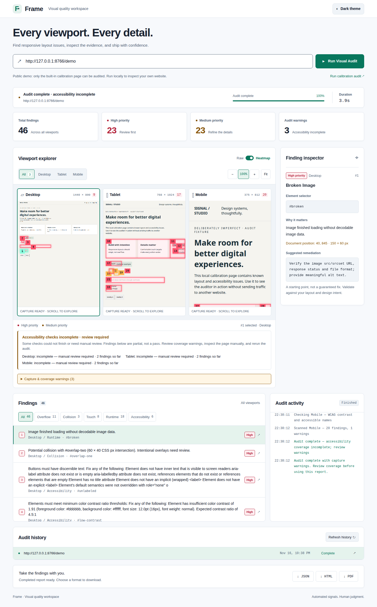

# FRAME — Visual UI Auditor

A visual QA workspace for finding responsive layout, usability, runtime, and accessibility issues across desktop, tablet, and mobile. Inspect findings on screenshots and export reports for human review.

**[Live demo on Render](https://visual-ui-auditor-1.onrender.com/)** · **[Detailed documentation](visual-ui-auditor/README.md)**

> **Deployment safety:** the updated Docker image defaults to a restricted public demo: only the bundled calibration page can be audited, with no target network access. Anonymous visitor sessions isolate new public audits and artifacts. These protections apply only after redeploying this version; the existing live deployment is not changed automatically. Use trusted local mode for your own development sites.



*Existing local calibration run; finding counts and timings are illustrative, not benchmarks.*

## Why FRAME?

A page that looks correct on a desktop can still overflow on a phone, hide a broken asset, or expose inaccessible controls. FRAME brings multiple viewport captures and automated findings into one inspection workflow, with locations, explanations, and suggested remediations rather than an unexplained score.

## Key features

- **Three viewport audits:** desktop 1440 × 900, tablet 768 × 1024, and mobile 375 × 812.
- **Five detection pillars:** horizontal overflow, potential collisions, touch-target usability, runtime/asset failures, and axe-core accessibility checks.
- **Visual inspection:** light-by-default dashboard with a remembered dark option, raw screenshots, heatmap overlays, numbered findings, viewport/pillar filters, zoom, and a finding inspector.
- **Durable progress:** SQLite audit history and events, WebSocket replay on reconnect, and interrupted-job handling on restart.
- **Portable exports:** JSON, self-contained HTML, and PDF reports.
- **Local calibration fixture:** exercise the workflow against a page with intentional issues.

## Technology stack

| Layer | Implementation |
| --- | --- |
| Backend | Python, FastAPI, Uvicorn, Pydantic |
| Browser auditing | Playwright with Chromium, JavaScript DOM checks, axe-core |
| Frontend | HTML, vanilla JavaScript, Canvas, locally compiled Tailwind CSS |
| Persistence and images | SQLite through aiosqlite, local PNG files, Pillow heatmaps |
| Verification and packaging | pytest, pytest-asyncio, HTTPX, Playwright browser tests, npm asset build, Dockerfile |

## Architecture

The dashboard submits an HTTP request to FastAPI. An in-process scheduler runs Playwright audits in fresh browser contexts for each viewport. DOM, accessibility, and runtime findings feed Pillow heatmaps and SQLite reports; progress returns over WebSockets. Screenshots are stored on disk, and export endpoints produce downloadable reports.

**The auditing browser runs on the server hosting FRAME—not on the dashboard visitor's device.**

## Run locally

Requires Python 3.11+ and Node.js 20+. From a terminal on Linux or macOS:

```bash
git clone https://github.com/dyson-25/visual-ui-auditor.git
cd visual-ui-auditor/visual-ui-auditor
python3 -m venv .venv
source .venv/bin/activate
python -m pip install -r requirements.txt
python -m playwright install chromium
npm ci
npm run build:css
PUBLIC_DEMO_MODE=false HOST=127.0.0.1 PORT=8000 .venv/bin/python -m backend.main
```

Open **http://localhost:8000**. The repeated directory name is intentional: application code and its dependency manifests are nested inside the repository. Use a single server worker. See the [installation guide](visual-ui-auditor/README.md#quick-start) for Windows and Linux browser-library setup, and [development commands](visual-ui-auditor/README.md#development) for tests.

## Limitations and safe use

- Findings are heuristics and automated accessibility checks, not a substitute for design review or an accessibility certification. Suggested fixes require validation.
- Login workflows are not implemented. Dynamic content can change captures; top-document layout checks and bounded page height limit coverage.
- Accessibility scanning uses pinned local axe-core. The multi-stage [Dockerfile](visual-ui-auditor/Dockerfile) builds Tailwind and includes only the required axe runtime asset and license, with a build-time path assertion. Reports distinguish checked/no violations, detected violations, and incomplete coverage.
- Only audit sites you own or have permission to test. Collision and touch findings require human review; a completed run is not an accessibility certification.
- Public mode is calibration-only, not an arbitrary-URL crawler. Signed anonymous cookies protect new public history, progress, reports and screenshots. Losing a cookie loses access; this is not an account/recovery system.
- Trusted local mode still supports private development sites and is not safe to expose publicly. Arbitrary-URL public auditing needs externally enforced isolated browser networking that covers DNS rebinding, redirects, WebSockets and subresources; a DNS lookup alone is insufficient.
- Public data has bounded retention and storage admission limits; existing unowned local audits are not automatically deleted. Hosted persistence depends on deployment storage. See [configuration and deployment](visual-ui-auditor/README.md#configuration).

See the existing [architecture](visual-ui-auditor/README.md#architecture), [API reference](visual-ui-auditor/README.md#api), [configuration](visual-ui-auditor/README.md#configuration), and [detailed limitations](visual-ui-auditor/README.md#reliability-and-limits).
