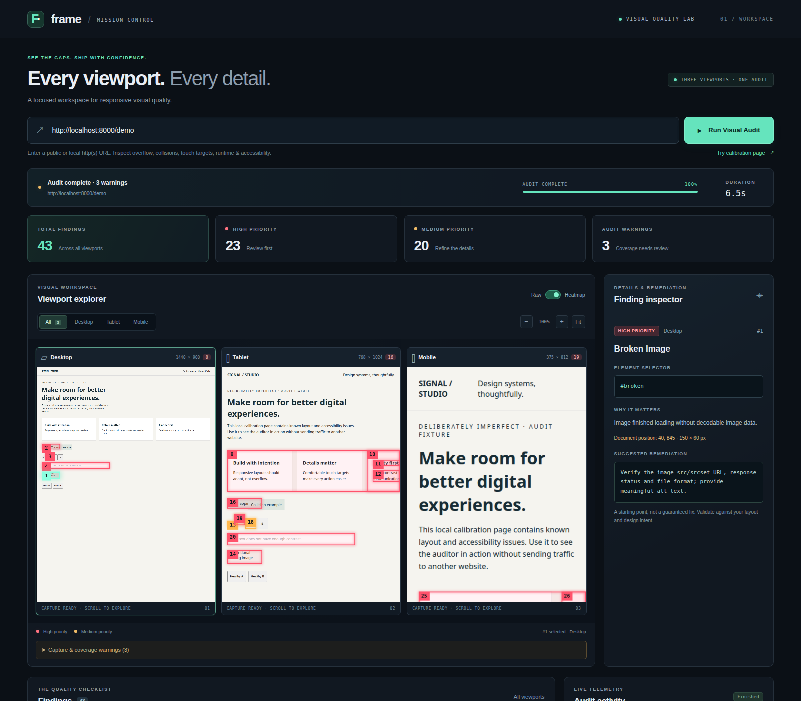

# FRAME — Visual UI Auditor

A visual QA workspace for finding responsive layout, usability, runtime, and accessibility issues across desktop, tablet, and mobile. Inspect findings on screenshots and export reports for human review.

**[Live demo on Render](https://visual-ui-auditor-1.onrender.com/)** · **[Detailed documentation](visual-ui-auditor/README.md)**

> **Deployment caveat:** the demo is publicly hosted, but the application was designed for trusted, single-user local use. It has no user authentication and intentionally permits local/private-network targets. Public availability is not evidence of production security. Do not submit sensitive URLs or content.



*Existing local calibration run; finding counts and timings are illustrative, not benchmarks.*

## Why FRAME?

A page that looks correct on a desktop can still overflow on a phone, hide a broken asset, or expose inaccessible controls. FRAME brings multiple viewport captures and automated findings into one inspection workflow, with locations, explanations, and suggested remediations rather than an unexplained score.

## Key features

- **Three viewport audits:** desktop 1440 × 900, tablet 768 × 1024, and mobile 375 × 812.
- **Five detection pillars:** horizontal overflow, potential collisions, touch-target usability, runtime/asset failures, and axe-core accessibility checks.
- **Visual inspection:** raw screenshots, heatmap overlays, numbered findings, viewport/pillar filters, zoom, and a finding inspector.
- **Durable progress:** SQLite audit history and events, WebSocket replay on reconnect, and interrupted-job handling on restart.
- **Portable exports:** JSON, self-contained HTML, and PDF reports.
- **Local calibration fixture:** exercise the workflow against a page with intentional issues.

## Technology stack

| Layer | Implementation |
| --- | --- |
| Backend | Python, FastAPI, Uvicorn, Pydantic |
| Browser auditing | Playwright with Chromium, JavaScript DOM checks, axe-core |
| Frontend | HTML, vanilla JavaScript, Canvas, locally compiled Tailwind CSS |
| Persistence and images | SQLite through aiosqlite, local PNG files, Pillow heatmaps |
| Verification and packaging | pytest, pytest-asyncio, HTTPX, Playwright browser tests, npm asset build, Dockerfile |

## Architecture

The dashboard submits an HTTP request to FastAPI. An in-process scheduler runs Playwright audits in fresh browser contexts for each viewport. DOM, accessibility, and runtime findings feed Pillow heatmaps and SQLite reports; progress returns over WebSockets. Screenshots are stored on disk, and export endpoints produce downloadable reports.

**The auditing browser runs on the server hosting FRAME—not on the dashboard visitor's device.**

## Run locally

Requires Python 3.11+ and Node.js 20+. From a terminal on Linux or macOS:

```bash
git clone https://github.com/dyson-25/visual-ui-auditor.git
cd visual-ui-auditor/visual-ui-auditor
python3 -m venv .venv
source .venv/bin/activate
python -m pip install -r requirements.txt
python -m playwright install chromium
npm ci
npm run build:css
HOST=127.0.0.1 PORT=8000 python -m backend.main
```

Open **http://localhost:8000**. The repeated directory name is intentional: application code and its dependency manifests are nested inside the repository. Use a single server worker. See the [installation guide](visual-ui-auditor/README.md#quick-start) for Windows and Linux browser-library setup, and [development commands](visual-ui-auditor/README.md#development) for tests.

## Limitations and safe use

- Findings are heuristics and automated accessibility checks, not a substitute for design review or an accessibility certification. Suggested fixes require validation.
- Login workflows are not implemented. Dynamic content can change captures; top-document layout checks and bounded page height limit coverage.
- Accessibility scanning requires the local axe-core package installed by `npm ci`. The current [Dockerfile](visual-ui-auditor/Dockerfile) does not install npm dependencies; a clean container build needs that provisioning step or accessibility coverage is reported as unavailable.
- Only audit sites you own or have permission to test. Same-origin checks and job limits are not authentication, rate limiting, or protection against server-side requests to internal services.
- Reports, history, and screenshots are not user-isolated. Keep sensitive content out of the public demo. Local storage requires an explicit retention policy; hosted persistence depends on deployment storage configuration.
- Before wider hosting, add an authenticated access boundary and isolated browser networking. Public-only auditing requires restrictions covering DNS changes, redirects, and subresources—not just URL syntax checks—and changes the intentional private-network auditing behavior.

See the existing [architecture](visual-ui-auditor/README.md#architecture), [API reference](visual-ui-auditor/README.md#api), [configuration](visual-ui-auditor/README.md#configuration), and [detailed limitations](visual-ui-auditor/README.md#reliability-and-limits).
