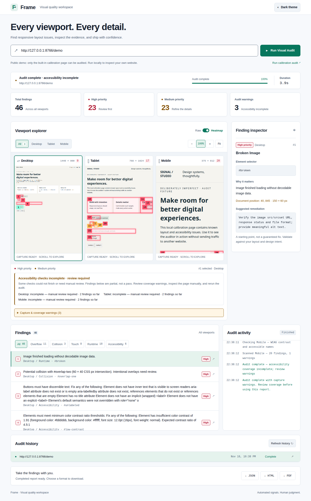
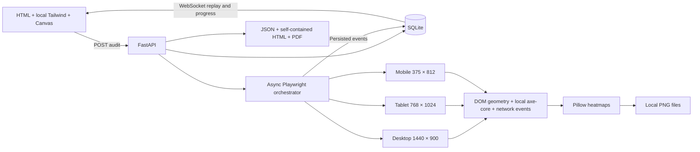

# Visual UI Auditor

Local-first visual QA across desktop **1440 × 900**, tablet **768 × 1024**, and mobile **375 × 812**. Inspect document-coordinate findings on interactive screenshots, replay live progress, and export portable reports.



*Actual local calibration run. Finding counts vary with browser versions and capture timing.*

## Quick start

Requires Python 3.11+ and Node.js 20+ (Node is only needed to install axe-core and build Tailwind). One isolated `.venv` is used for this project.

```bash
cd visual-ui-auditor
python3 -m venv .venv
source .venv/bin/activate
pip install -r requirements.txt
python -m playwright install chromium
npm ci
npm run build:css
PUBLIC_DEMO_MODE=false .venv/bin/python -m backend.main
```

For this checkout, both VS Code workspace configurations select `/home/dyson/p1/visual-ui-auditor/.venv/bin/python`. Run **Tasks: Run Task → Visual UI Auditor: serve** from either the parent workspace or this project. The task uses that exact interpreter and project working directory; it does not create an environment. Do not create a second `.venv` in `/home/dyson/p1`. If VS Code has cached another interpreter, use **Python: Select Interpreter** to select the project environment. These checkout-specific paths must be updated if the project is moved.

Open **http://localhost:8000**. On Linux, if Chromium reports missing shared libraries, install its OS dependencies with `python -m playwright install-deps chromium` (requires administrator approval). Do not use a system-wide pip install.

Windows PowerShell: create the environment with `py -3 -m venv .venv` only if absent, activate with `.venv\Scripts\Activate.ps1`, then use the same install/build commands. For trusted local auditing run `$env:PUBLIC_DEMO_MODE='false'; .venv\Scripts\python.exe -m backend.main`. Select `.venv\Scripts\python.exe` with VS Code's **Python: Select Interpreter** command.

The **Try calibration page** button audits a bundled fixture with intentional issues. Audit only websites you own or have permission to test. Trusted local mode deliberately supports localhost and private-network sites; the browser runs on the machine hosting this service, not the dashboard client's computer. The Docker image defaults to **public calibration-only mode**, which does not visit arbitrary target websites.

Reuse an existing `.venv` and `node_modules` when available; create an environment only for a fresh checkout. Run Python commands through `.venv/bin/python` (Windows: `.venv\\Scripts\\python.exe`). Never install project Python packages globally.

## Architecture



## Inspecting findings

- The dashboard defaults to **Light**. The header theme button switches to **Dark** and remembers the explicit choice on this browser. Both themes retain visible focus, reduced-motion support and readable warning states. Themes never recolor captured target screenshots.
- Hover a heatmap box or numbered badge for a pointer cursor. Click a badge to select that finding; repeated clicks in overlapping boxes cycle through the findings. Canvas clicks preserve zoom and scroll position. Raw mode disables overlay hit-testing.
- Click a finding in the checklist to smoothly return to the visual workspace and position its screenshot at the finding. The inspector stays alongside the capture on desktop and in a compact, scrollable panel on smaller screens. Reduced-motion preferences disable smooth scrolling.
- Viewport tabs scope the checklist; pillar tabs filter it. Zoom ranges from 50% to 400% of the fitted canvas width. Click the percentage to reset to 100%; **Fit** also returns captures to their top-left corner. Findings without visible coordinates remain readable in the inspector.

## Detection pillars

| Pillar | Checks | Interpretation |
| --- | --- | --- |
| Layout overflow | Visible boxes beyond either horizontal viewport edge | Candidate responsive-layout defect |
| Collisions | Intersecting unrelated text/control boxes | Heuristic; intentional overlays need review |
| Touch usability | Under 44 × 44 CSS px; controls less than 4 px apart | Ergonomic recommendation, not a claim that every target fails WCAG |
| Runtime & assets | Broken images, HTTP 4xx/5xx, request failures, console errors, uncaught JS errors | Runtime issues have no invented DOM coordinates |
| Accessibility | axe-core WCAG 2 A/AA, WCAG 2.1 AA checks including contrast and labels | Automated findings, not an accessibility certification |

Every finding includes a CSS selector (when available), severity, explanation, document-coordinate rectangle, and a **suggested** remediation. CSS changes are proposals requiring human review; the auditor cannot infer a universally correct fix for arbitrary designs. Console findings preserve their URL/line information and uncaught errors retain their stack source when supplied by Chromium.

Accessibility coverage is explicit per viewport and in the report summary: `passed` means axe executed with no detected violations or incomplete rules; `violations` means it executed and found violations; `incomplete` means a dependency, timeout, rule requiring manual review, or finding cap prevented complete coverage. When axe could not execute, `accessibility_issue_count` is `null`, never a clean zero. Known findings can still coexist with incomplete coverage. Old reports without coverage metadata are shown as unknown/incomplete. Dashboard warnings and JSON/HTML/PDF exports retain this distinction; a completed job does not mean all checks passed.

## Reliability and limits

- CSS transitions/animations and caret blinking are disabled; reduced motion is requested. JavaScript animations, video, delayed ads, consent dialogs, and authenticated content can still affect captures.
- Each viewport uses a fresh browser context, without your personal browser cookies. Login workflows are not implemented.
- The scanner examines the top document, not arbitrary iframe contents or shadow DOM layout. axe may inspect additional accessible structures; nodes without a top-document rectangle remain inspector-only findings.
- Scan size, pair comparisons, console/network findings, maximum captured height, total job duration, and concurrent jobs are bounded. Truncation and skipped checks are reported as warnings, not success.
- Screenshots use CSS pixels and document coordinates. Very tall pages are clipped at the configured height. Below-capture findings remain in the report but cannot be highlighted on that image.
- Runs continue if the dashboard disconnects. Progress is persisted and replayed on reconnect. Restart-interrupted jobs are marked failed rather than staying pending forever.
- **Local mode is trusted and single-user.** It intentionally accesses local/private addresses. Do not expose local mode publicly or run it with cloud credentials or sensitive internal access. Target pages execute JavaScript in Chromium. Public mode instead only renders the trusted bundled fixture and blocks target network traffic. It is not a claim that arbitrary pages can be secured by URL validation alone.
- Reports and screenshots may contain sensitive website content. They stay in `backend/storage`; no analytics or external AI services are used. Public anonymous sessions provide isolation, not authenticated identities. Public retention only applies to newly owned public data; legacy local runs remain untouched and are hidden from public visitors.
- Keep the default single Uvicorn worker. SQLite job state is durable, but scheduling is intentionally in-process.

## Configuration

Use [.env.example](.env.example) as a reference; do not overwrite an existing private `.env`. Restart after changing settings. Prefer absolute storage paths.

| Setting | Purpose / default |
| --- | --- |
| `PUBLIC_DEMO_MODE` | Safe application default `true`: only the bundled calibration page, no arbitrary targets. Set `false` only for trusted local development. |
| `AUDITOR_SESSION_SECRET` | Optional random secret, at least 32 bytes, kept in the hosting secret manager. If absent, a process-local random key invalidates sessions on restart. Never commit a real value. |
| `PUBLIC_ORIGIN` | Canonical HTTPS origin behind a reverse proxy, e.g. `https://your-service.onrender.com`, in both public-demo and unrestricted modes. Falls back to Render's `RENDER_EXTERNAL_URL`; invalid values fail startup. HTTP/WebSocket origin checks and the trusted host list use this origin without trusting forwarded headers. When neither variable is set, the request origin is used. |
| `AUDITOR_STORAGE` | Database/screenshots root; default `backend/storage`. Use an absolute mounted path for persistence. |
| `PUBLIC_AUDIT_RETENTION_SECONDS` | New public audit retention, default 86400 (24 hours). Existing local data is not automatically deleted. |
| `PUBLIC_STORAGE_MAX_MB` | Public storage admission limit, default 256 MB. Requests are refused when capacity is exhausted. |
| `HOST`, `PORT` | Direct Python launcher defaults: `127.0.0.1`, `8000`. Docker binds `0.0.0.0:8000`. |
| `NAVIGATION_TIMEOUT_MS`, `AUDIT_TIMEOUT_SECONDS` | Navigation/job timeouts, defaults 30000 ms / 180 s. |
| `MAX_PAGE_HEIGHT` | Maximum capture height, default 16000 px; clipping is reported. |
| `MAX_CONCURRENT_AUDITS` | Local concurrent jobs, default 2. Public mode uses stricter bounds. |

### Public demo and deployment

Public mode only accepts the application's calibration URL. Chromium receives the bundled HTML through local request fulfillment; it does not fetch that URL from the network. Subsequent network requests, redirects, WebSockets and service workers are restricted. This stronger fallback rejects arbitrary IPv4/IPv6, localhost, metadata, private **and public** targets instead of claiming DNS validation alone stops rebinding. No setting enables arbitrary public-site crawling. Do not add it without enforced worker egress isolation and an appropriate access boundary. Application interception is not an OS/container firewall.

Signed, HttpOnly, same-site anonymous cookies associate new public audits with their visitor. Ownership applies to history, details, JSON/HTML/PDF exports, screenshots and WebSocket progress. The client header is only a same-origin request guard, not authentication. Use HTTPS on Render. Clearing cookies, changing the secret or using a different browser loses access; there is no account recovery. Legacy unowned audits are hidden publicly and remain available in trusted local mode.

Public submission limits are 5 per session/hour and 20 per client IP/hour, with one running browser audit and four outstanding jobs. Public retention is capped at 100 audits, with 16 MiB of screenshots plus a 2 MiB report budget per audit; cleanup runs every 60 seconds. Cookies expire after seven days. Limits and scheduling are in-process: **run one Uvicorn worker and one instance**. A proxy can cause shared-IP throttling; do not trust arbitrary forwarded headers. Storage limits are admission controls, not filesystem quotas: leave disk headroom and use platform disk limits where available. Retention applies only to newly owned public audits, never existing local audit files. Ephemeral hosting storage disappears on redeploy unless a persistent disk is mounted.

`PUBLIC_DEMO_MODE` only disables protection for an explicit `false`, `0` or `no` (case-insensitive). Empty values, `off` and misspellings remain restricted. The exported application defaults public; the Python `create_app(storage)` test/local factory deliberately defaults local. Any new public entrypoint must explicitly pass `SecurityConfig.from_env()` rather than relying on that factory's local default.

1. In Render, set the service root directory to `visual-ui-auditor` and use its Dockerfile. Do not deploy the repository root as the Docker build context.
2. Set `PUBLIC_DEMO_MODE=true`, supply a securely generated `AUDITOR_SESSION_SECRET`, and optionally configure `AUDITOR_STORAGE` with a mounted persistent disk. Set `PUBLIC_ORIGIN=https://your-service.onrender.com` or retain Render's automatically supplied `RENDER_EXTERNAL_URL`. Do not copy a developer `.env` into the image. Keep `--no-proxy-headers` in the Docker command; never use `--forwarded-allow-ips="*"`. The canonical origin handles HTTPS/WSS correctly without trusting spoofable forwarded addresses. Behind Render, the conservative IP quota may be shared by visitors using the same proxy hop.
3. Build locally where Docker is authorized: `docker build -t frame:local visual-ui-auditor` from the repository root. The Node 20 stage runs `npm ci` and the Tailwind build. The Python 3.11 runtime includes Chromium plus axe's exact expected asset/license, but no Node development dependencies.
4. Check the runtime asset: `docker run --rm --entrypoint python frame:local -c "from backend.engine.a11y_scanner import AXE_PATH; assert AXE_PATH.is_file()"`. Then start the image with `docker run --rm -p 127.0.0.1:8000:8000 frame:local` and run the calibration audit. Check all three viewport coverage states and download all report formats.
5. After manually pushing and redeploying, repeat the calibration check over HTTPS. In a second private browser session, verify the first session's history, report URLs, screenshots and progress are inaccessible. Confirm arbitrary targets are rejected.

**Tracked environment-file cleanup:** this change removes the private `.env` from the index and adds Git/Docker exclusions without deleting the local file. Its contents were not inspected. The filename existed in prior commits; removing it now does not remove history. If it ever contained credentials, rotate every affected API key, token, password or signing secret in its issuing service before deployment. Review history privately. Historical removal with `git filter-repo` requires a separately coordinated backup, collaborator plan and explicit authorization; no history rewrite, commit, push or deployment is performed here.

## API

| Endpoint | Result |
| --- | --- |
| `POST /api/audit` | Accepts `{ "url": "http://localhost:8000/demo" }`; returns HTTP 202 and `audit_id` |
| `WS /ws/audit/{audit_id}?after=0` | Ordered persisted progress events; reconnect with the last `seq` |
| `GET /api/audit/{audit_id}` | Status, error, and completed report with viewport findings |
| `GET /api/audits` | Latest 20 audit summaries (visitor-owned in public mode) |
| `GET /api/config` | Public-demo mode flag; no secrets |
| `GET /api/audit/{audit_id}/export/{format}` | Download JSON, standalone HTML, or PDF |

POST requests require `X-Audit-Client: dashboard` and JSON content type. Browser requests must be same-origin. Public API clients must retain the anonymous session cookie returned by the dashboard and send it on subsequent requests; the header is not authentication. WebSockets emit `{seq,status,progress,message}`, optional heartbeat messages, and a terminal status before closing. Exports return HTTP 409 until completion; a full job queue returns HTTP 429. Open `/docs` for the HTTP API schema (include the client header when calling POST).

```bash
curl -X POST http://localhost:8000/api/audit \
  -H 'Content-Type: application/json' \
  -H 'X-Audit-Client: dashboard' \
  -d '{"url":"http://localhost:8000/demo"}'
```

## Development

```bash
python -m pytest -q
npm run build:css
python -m backend.engine.orchestrator http://localhost:8000/demo
```

The standalone command captures three raw screenshots before any dashboard is required. Browser integration tests use a loopback fixture, never a public site.

Third-party dependencies retain their respective licenses. axe-core is installed locally from its pinned npm package; its license is included in that package. Tailwind CSS is compiled locally; no runtime CDN is required.
