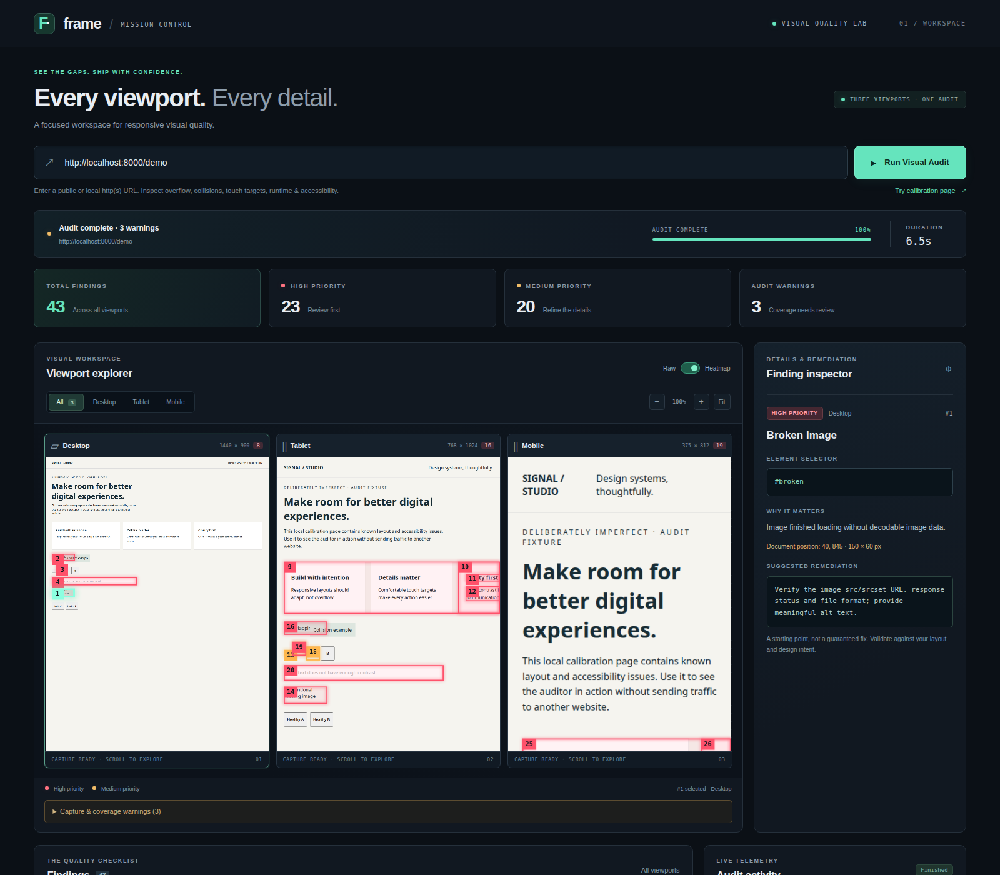
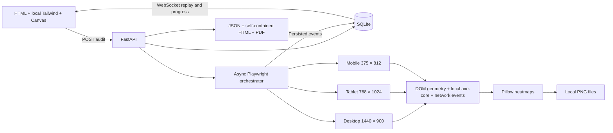

# Visual UI Auditor

Local-first visual QA across desktop **1440 × 900**, tablet **768 × 1024**, and mobile **375 × 812**. Inspect document-coordinate findings on interactive screenshots, replay live progress, and export portable reports.



*Actual local calibration run. Finding counts vary with browser versions and capture timing.*

## Quick start

Requires Python 3.11+ and Node.js 20+ (Node is only needed to install axe-core and build Tailwind). One isolated `.venv` is used for this project.

```bash
cd visual-ui-auditor
python3 -m venv .venv
source .venv/bin/activate
pip install -r requirements.txt
python -m playwright install chromium
npm ci
npm run build:css
python -m backend.main
```

For this checkout, both VS Code workspace configurations select `/home/dyson/p1/visual-ui-auditor/.venv/bin/python`. Run **Tasks: Run Task → Visual UI Auditor: serve** from either the parent workspace or this project. The task uses that exact interpreter and project working directory; it does not create an environment. Do not create a second `.venv` in `/home/dyson/p1`. If VS Code has cached another interpreter, use **Python: Select Interpreter** to select the project environment. These checkout-specific paths must be updated if the project is moved.

Open **http://localhost:8000**. On Linux, if Chromium reports missing shared libraries, install its OS dependencies with `python -m playwright install-deps chromium` (requires administrator approval). Do not use a system-wide pip install.

Windows PowerShell: create the environment with `py -3 -m venv .venv`, activate with `.venv\Scripts\Activate.ps1`, then use the same commands starting with `pip install`. Select `.venv\Scripts\python.exe` with VS Code's **Python: Select Interpreter** command.

The **Try calibration page** button audits a local fixture with intentional issues. Audit only websites you own or have permission to test. Localhost and private-network sites are deliberately supported; the browser runs on the machine hosting this service, not the dashboard client's computer.

## Architecture



## Inspecting findings

- Hover a heatmap box or numbered badge for a pointer cursor. Click a badge to select that finding; repeated clicks in overlapping boxes cycle through the findings. Canvas clicks preserve zoom and scroll position. Raw mode disables overlay hit-testing.
- Click a finding in the checklist to smoothly return to the visual workspace and position its screenshot at the finding. The inspector stays alongside the capture on desktop and in a compact, scrollable panel on smaller screens. Reduced-motion preferences disable smooth scrolling.
- Viewport tabs scope the checklist; pillar tabs filter it. Zoom ranges from 50% to 400% of the fitted canvas width. Click the percentage to reset to 100%; **Fit** also returns captures to their top-left corner. Findings without visible coordinates remain readable in the inspector.

## Detection pillars

| Pillar | Checks | Interpretation |
| --- | --- | --- |
| Layout overflow | Visible boxes beyond either horizontal viewport edge | Candidate responsive-layout defect |
| Collisions | Intersecting unrelated text/control boxes | Heuristic; intentional overlays need review |
| Touch usability | Under 44 × 44 CSS px; controls less than 4 px apart | Ergonomic recommendation, not a claim that every target fails WCAG |
| Runtime & assets | Broken images, HTTP 4xx/5xx, request failures, console errors, uncaught JS errors | Runtime issues have no invented DOM coordinates |
| Accessibility | axe-core WCAG 2 A/AA, WCAG 2.1 AA checks including contrast and labels | Automated findings, not an accessibility certification |

Every finding includes a CSS selector (when available), severity, explanation, document-coordinate rectangle, and a **suggested** remediation. CSS changes are proposals requiring human review; the auditor cannot infer a universally correct fix for arbitrary designs. Findings from axe's incomplete checks are warnings, not silently counted as passes.

## Reliability and limits

- CSS transitions/animations and caret blinking are disabled; reduced motion is requested. JavaScript animations, video, delayed ads, consent dialogs, and authenticated content can still affect captures.
- Each viewport uses a fresh browser context, without your personal browser cookies. Login workflows are not implemented.
- The scanner examines the top document, not arbitrary iframe contents or shadow DOM layout. axe may inspect additional accessible structures; nodes without a top-document rectangle remain inspector-only findings.
- Scan size, pair comparisons, console/network findings, maximum captured height, total job duration, and concurrent jobs are bounded. Truncation and skipped checks are reported as warnings, not success.
- Screenshots use CSS pixels and document coordinates. Very tall pages are clipped at the configured height. Below-capture findings remain in the report but cannot be highlighted on that image.
- Runs continue if the dashboard disconnects. Progress is persisted and replayed on reconnect. Restart-interrupted jobs are marked failed rather than staying pending forever.
- This is a **trusted, single-user, localhost application**, not a hosted multi-tenant service. It intentionally accesses local/private addresses. Do not bind it publicly, tunnel it, or run it with cloud credentials or access to sensitive internal services. Target pages execute JavaScript in Chromium. Same-origin mutation checks and host validation reduce accidental cross-site use, but are not a substitute for authentication or network isolation.
- Reports and screenshots may contain sensitive website content. They stay in `backend/storage`; no analytics or external AI services are used. Browser requests to the URL you submit are required. Remove old runs from that folder and database when no longer needed.
- Keep the default single Uvicorn worker. SQLite job state is durable, but scheduling is intentionally in-process.

## Configuration

Edit [.env](.env): `HOST`, `PORT`, `NAVIGATION_TIMEOUT_MS`, `AUDIT_TIMEOUT_SECONDS`, `MAX_PAGE_HEIGHT`, and `MAX_CONCURRENT_AUDITS`. Restart the service after changes. Relative storage paths always resolve to this project, independent of the shell's working directory.

## API

| Endpoint | Result |
| --- | --- |
| `POST /api/audit` | Accepts `{ "url": "http://localhost:8000/demo" }`; returns HTTP 202 and `audit_id` |
| `WS /ws/audit/{audit_id}?after=0` | Ordered persisted progress events; reconnect with the last `seq` |
| `GET /api/audit/{audit_id}` | Status, error, and completed report with viewport findings |
| `GET /api/audits` | Latest 20 audit summaries |
| `GET /api/audit/{audit_id}/export/{format}` | Download JSON, standalone HTML, or PDF |

POST requests require `X-Audit-Client: dashboard` and JSON content type. Browser requests must be same-origin. WebSockets emit `{seq,status,progress,message}`, optional heartbeat messages, and a terminal status before closing. Exports return HTTP 409 until completion; a full job queue returns HTTP 429. Open `/docs` for the HTTP API schema (include the client header when calling POST).

```bash
curl -X POST http://localhost:8000/api/audit \
  -H 'Content-Type: application/json' \
  -H 'X-Audit-Client: dashboard' \
  -d '{"url":"http://localhost:8000/demo"}'
```

## Development

```bash
python -m pytest -q
npm run build:css
python -m backend.engine.orchestrator http://localhost:8000/demo
```

The standalone command captures three raw screenshots before any dashboard is required. Browser integration tests use a loopback fixture, never a public site.

Third-party dependencies retain their respective licenses. axe-core is installed locally from its pinned npm package; its license is included in that package. Tailwind CSS is compiled locally; no runtime CDN is required.
